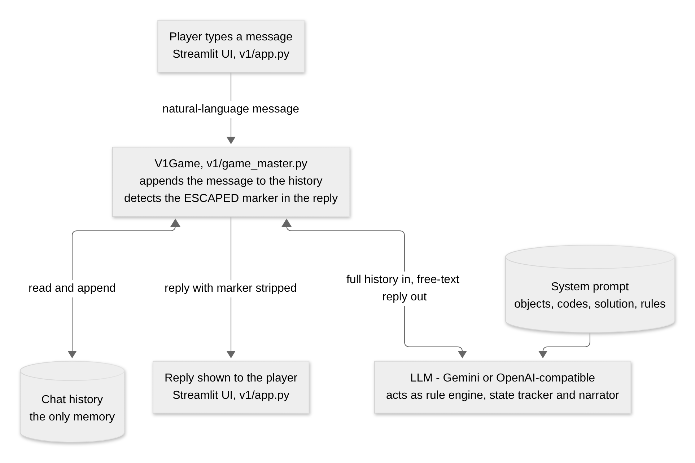
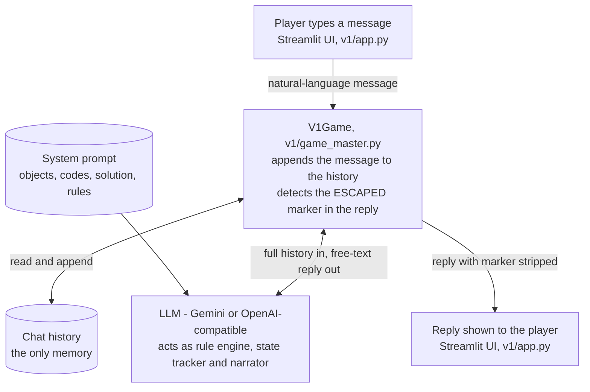

# Architecture - Version 1 (LLM-only Game Master)

Mermaid source (renders natively on GitHub)

## Components

| Component | File | Responsibility |
|-----------|------|----------------|
| Streamlit UI | `v1/app.py` | Chat box, intro text, restart button |
| `V1Game` | `v1/game_master.py` | Keeps the chat history, calls the LLM, detects the escape marker |
| System prompt | `v1/game_master.py` | Describes the room, **contains every secret and the solution**, and states the rules |
| LLM client | `common/llm.py` | Provider-agnostic wrapper (Gemini or any OpenAI-compatible API) |

## How a turn works

1. The player types a message.
2. `V1Game` appends it to the history and sends *system prompt + whole history* to the LLM.
3. The LLM decides, by itself, what is allowed, what exists and what has already happened.
4. If the reply contains the `[ESCAPED]` marker the game is over.

## Why this is fragile (by construction)

- **No game state.** "Which puzzles are solved?" exists only as prose in the chat history.
- **Secrets are in the prompt.** The model can repeat codes if asked cleverly.
- **The LLM is the rule engine.** Whether the key may be used, or the drawer opened, is a probabilistic judgement.
- **Trust.** Player text and rules share one channel, so player text can try to override the rules.
