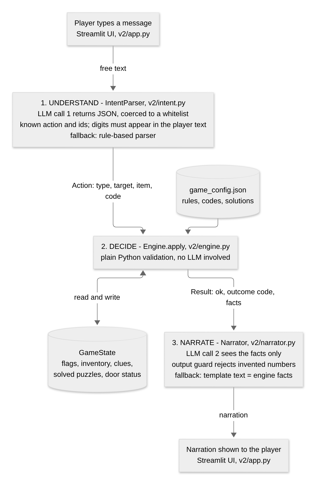
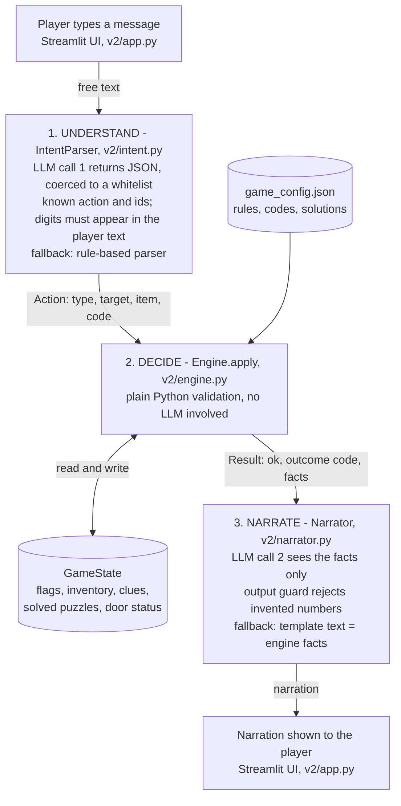

# Architecture - Version 2 (Reliable AI Escape Room)

Mermaid source (renders natively on GitHub)

## Components

| Component | File | Responsibility |
|-----------|------|----------------|
| `game_config.json` | `v2/game_config.json` | All rooms, objects, items, clues, **codes and rules** - outside any LLM output |
| `GameState` | `v2/state.py` | Structured, JSON-serialisable state: flags, inventory, clues, solved puzzles, door status, attempts, log |
| `Engine` | `v2/engine.py` | **Decides** whether every action succeeds: inventory rule, visibility rule, lock rules, required-puzzle rule, game-over rule |
| `IntentParser` | `v2/intent.py` | Free text -> one `Action` from a closed list. LLM first, deterministic rules as fallback |
| `Narrator` | `v2/narrator.py` | Turns engine facts into atmosphere; guard discards prose that contradicts the facts |
| `EscapeRoomGame` | `v2/pipeline.py` | Wires the above together for one turn |
| Streamlit UI | `v2/app.py` | Chat, progress bar, inventory, clue log, restart, debug view |

## Where the LLM is (and is not) trusted

| Step | LLM role | Can the LLM change the game state? |
|------|----------|-----------------------------------|
| Parse | Translates text into a JSON action | No - output is coerced to a whitelist and then validated by the engine |
| Validate / decide | **None** - plain Python | - |
| Narrate | Writes prose from facts | No - prose is display-only and is checked by the guard |

## Design rules that make it reliable

1. **Python decides, the LLM describes.** `Engine.apply` is the only code that mutates `GameState`.
2. **Closed action vocabulary.** Even a jailbroken parser can only emit `examine / take / use / enter_code / open / ...`.
3. **The model cannot invent input.** A code is accepted only if its digits literally appear in the player's message.
4. **Least information.** The narrator never receives the player's raw text or any unsolved solution.
5. **Required-puzzle rule.** A lock does not test a code until the clues that make it knowable were discovered - lucky guesses and leaked codes cannot skip the puzzle chain.
6. **Graceful degradation.** If the LLM is unreachable or misbehaves, the game continues with rule-based parsing and template text.
